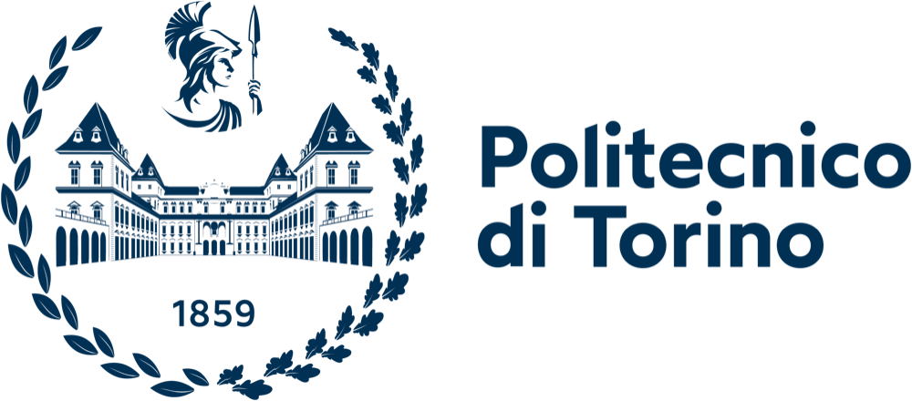

  

<h1 align="center">IoT and Cloud for Sustainable Communities</h1>

  Course code and exercises — Politecnico di Torino 
  Master's degree in <a href="https://www.polito.it/en/education/master-s-degree-programmes/digital-skills-for-sustainable-societal-transitions"><b>Digital Skills for Sustainable Societal Transitions</b></a>

  
  
  
  

---

## 👨‍🏫 Teaching staff

| Role | Name |
|---|---|
| Lecturer | **Prof. Lorenzo Bottaccioli** |
| Teaching assistant | **Pietro Rando Mazzarino** |

## 📚 Contents

This repository contains the code for the course **"IoT and Cloud for sustainable communities"**, course of the Master's degree programme [**Digital Skills for Sustainable Societal Transitions**](https://www.polito.it/en/education/master-s-degree-programmes/digital-skills-for-sustainable-societal-transitions) at Politecnico di Torino.

The course teaches how to design IoT platforms as Python microservices, step by step: object-oriented programming, REST web services, MQTT messaging, cloud data storage (ThingSpeak) and Telegram bots. Each lesson adds one module to a single running project: a smart home with per-room temperature/humidity sensors and HVAC control, configured in JSON and scalable to many houses.

| Folder | Description |
|---|---|
| [`2026_2027/`](2026_2027/README.md) | Academic year 2026/2027: lessons `L01`–`L13` (each with `starter/` and `solution/`) and the `smart_home/` example project |
| [`2025_2026/`](2025_2026/) | Academic year 2025/2026 |
